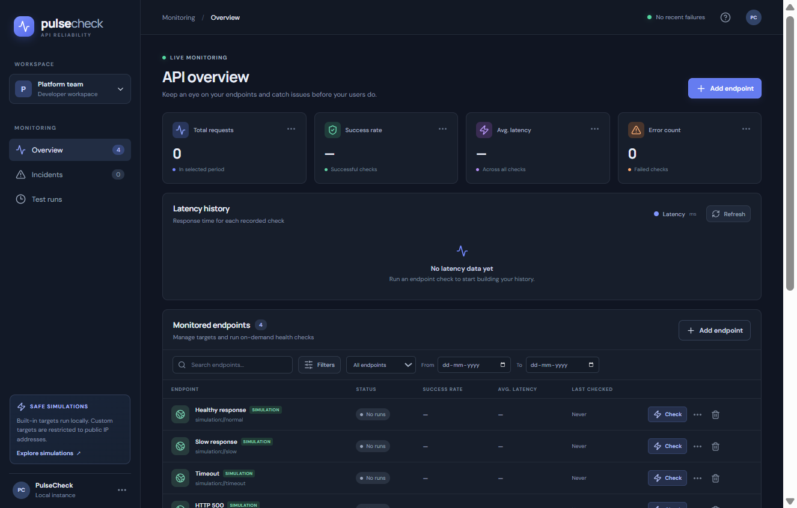
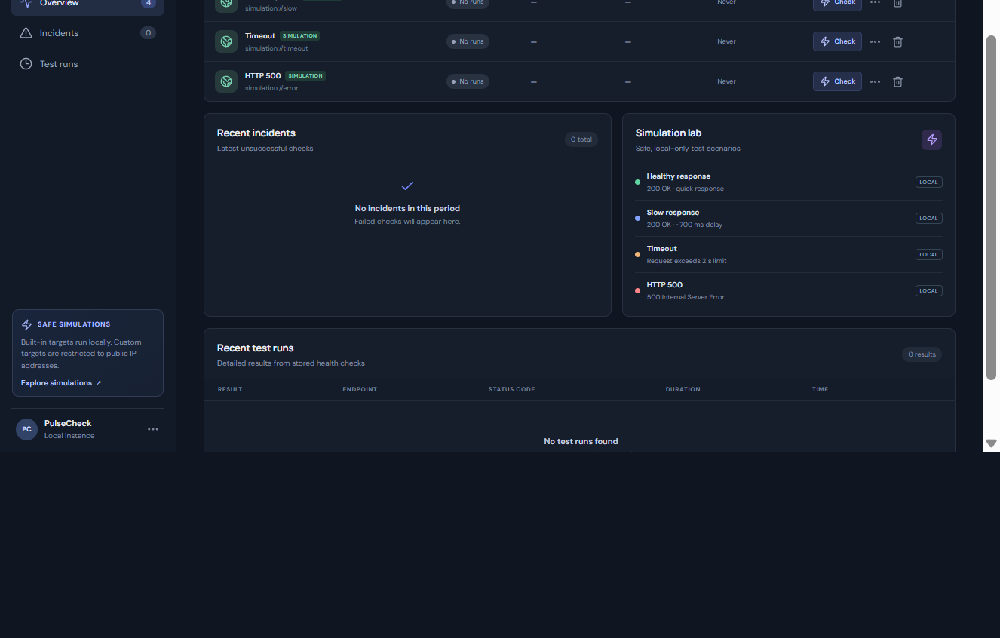

# PulseCheck — API Reliability & Incident Simulator

PulseCheck is a local developer dashboard for managing API monitors, executing on-demand HTTP health checks, and exploring controlled incident scenarios. Local development and tests use SQLite; production can use PostgreSQL through `DATABASE_URL`. Dashboard metrics are calculated from stored checks, not generated sample values.

## Live demo

- [Open the PulseCheck dashboard](https://pulsecheck-5su5.onrender.com/)
- [Check API health](https://pulsecheck-5su5.onrender.com/api/health)

The demo runs on Render's Free service and may take a little longer to respond after periods of inactivity.

### Screenshots





## Requirements

- Node.js 22.5 or newer (uses the built-in `node:sqlite` module)
- npm 10 or newer

`node:sqlite` is still marked experimental in some supported Node releases, so Node may print an experimental-feature warning at startup.

## Setup and run

From the project root:

```bash
npm install
npm run dev
```

Authentication is required before starting the API. Configure Clerk's server secret and publishable keys, plus the same publishable key for Vite:

```text
CLERK_SECRET_KEY=...
CLERK_PUBLISHABLE_KEY=...
VITE_CLERK_PUBLISHABLE_KEY=...
```

Set these in your local process environment or a local `.env` file for Vite. Node does not automatically load `.env` files, so the two `CLERK_*` values must also be present in the API process environment. Keep the secret key private; only the publishable key is used by the browser. `OPENAI_API_KEY` is needed to run AI investigations, but not to use the monitoring dashboard.

Open the Vite URL printed in the terminal (normally `http://127.0.0.1:5173`) and sign in through Clerk. The API listens on `http://127.0.0.1:3001`; Vite proxies `/api` requests to it.

For a production frontend build and API server:

```bash
npm run build
npm start
```

In production (`NODE_ENV=production`), the API server also serves the built frontend from `frontend/dist` and listens on all interfaces. Set `PORT` to change the API port. When `DATABASE_URL` is set, the server uses PostgreSQL; otherwise it uses SQLite at `DATABASE_PATH` (default `pulsecheck.sqlite`). Without production mode, the API binds to `127.0.0.1`; during development Vite serves the frontend and proxies `/api` to the API. The server refuses to start without `CLERK_SECRET_KEY` and `CLERK_PUBLISHABLE_KEY`; the frontend build requires `VITE_CLERK_PUBLISHABLE_KEY`.

### Free Render + Neon deployment

The root `render.yaml` defines a single Free Node web service that installs development dependencies for the Vite build (`npm ci --include=dev`), builds and serves the frontend through Express, and uses `/api/health` as its health check. Configure the `CLERK_SECRET_KEY`, `CLERK_PUBLISHABLE_KEY`, and `VITE_CLERK_PUBLISHABLE_KEY` Render environment variables with the keys from your Clerk application. Configure `OPENAI_API_KEY` only when enabling investigations. For persistent production data, provide a Neon PostgreSQL connection URL through Render's `DATABASE_URL` environment variable. Do not commit any of these secrets. The server uses PostgreSQL when that variable is configured and SQLite for local development/tests. It refuses to start in production without `DATABASE_URL`.

Render Free web services have ephemeral local filesystems and can sleep when idle, so the local SQLite database is not used on the hosted service. Neon Free currently provides 1 GB/project and 100 CU-hours/project/month; it scales to zero after five minutes. Render's free service also has usage limits and cold starts. Review the [Render Free limits](https://render.com/docs/free) and [Neon Free plan](https://neon.com/docs/introduction/plans), keep both services on their Free plans, and do not attach a Render disk.

## Architecture

- `frontend/` — React single-page dashboard, Vite development server, and Recharts latency history.
- `backend/src/app.js` — Express API routes, validation integration, and metric queries.
- `backend/src/security.js` — endpoint input validation and public-address/DNS checks.
- `backend/src/monitor.js` — timed HTTP requests and result normalization.
- `backend/src/services.js` — shared monitoring, history, summary, and simulation operations used by both the HTTP API and agent tools.
- `backend/src/agent-tools.js` — provider-neutral tool definitions and validated tool handlers.
- `backend/src/agent.js` — bounded investigation loop, schema validation, tool dispatch, and execution policy.
- `backend/src/openai-provider.js` — OpenAI SDK adapter behind the provider interface.
- `backend/src/investigation-prompt.js` — system instructions for evidence-based investigations.
- `backend/src/database.js` — local SQLite and production PostgreSQL adapters, schemas, indexes, and initial simulation endpoint records.
- `backend/tests/` — Vitest and Supertest API integration tests.

The backend is bound to the IPv4 loopback interface by default. Simulation targets are represented by `simulation://` identifiers in the endpoint registry and are translated by the backend to its own loopback HTTP simulation routes. The mock routes are never arbitrary proxy destinations.

## Agent tool layer

The backend exports eight provider-neutral tools from `backend/src/agent-tools.js`. Create a tool instance with the existing database adapter and the listening server port (needed for local simulation checks):

```js
import { createAgentTools } from './src/agent-tools.js';
import { createDatabase } from './src/database.js';

const db = createDatabase();
const tools = createAgentTools({ db, serverPort: 3001 });
const result = await tools.get_service_health({});
// { ok: true, data: { status: 'ok' } }
```

Each handler accepts a JSON-compatible argument object and returns `{ ok: true, data }` or `{ ok: false, error: { code, message } }`. `tools.definitions` provides names, descriptions, JSON input schemas, and effect metadata. `get_service_health`, `list_monitors`, `get_check_history`, `get_monitoring_summary`, `get_recent_failures`, and `list_simulations` are read-only. `run_endpoint_check` performs and persists a check; `run_simulation` executes a built-in local scenario without persisting a check. Recent failures are filtered in the database query rather than fetched alongside successful runs.

Example:

```js
const history = await tools.get_check_history({
  endpointId: 1,
  from: '2026-11-01',
  to: '2026-11-04',
  limit: 50
});
```

The tool layer does not accept arbitrary SQL or URLs. A check can only target a monitor already in the database, and custom monitor URLs continue to use the existing public-address validation and DNS pinning. Tool handlers have no authentication of their own; keep them inside trusted server-side code and do not expose them directly to unauthenticated clients.

## AI investigation agent

The agent is a backend-only, bounded tool-calling loop. The OpenAI adapter sends the user's question, an investigation system prompt, and JSON-schema tool descriptions to the model. The backend validates requested names and arguments. Read-only handlers may run during the investigation; operational requests stop the loop and create a persisted pending approval instead of invoking a handler. The API executes the stored, validated operation only after an explicit approval request and a conditional pending-state claim. The agent does not access the database directly and does not apply production fixes.

All client-facing `/api/*` routes require a Clerk-authenticated bearer token except `GET /api/health`, which remains public for deployment health checks. The server's own local simulation health-check requests use an unpredictable per-process token and do not expose an unauthenticated client route. The backend derives the user ID from Clerk's verified request context; owner IDs in request bodies or query parameters are ignored. Investigation history and approvals are scoped to that user, and one user's approval cannot be viewed or decided by another. Existing investigations that predate ownership remain ownerless and are hidden from all users; they are not automatically assigned to the first person who signs in.

Authenticated users share the monitoring workspace and its endpoint/check data. Investigation requests are limited to 5 per authenticated user per 15-minute window. The limiter is stored in the application database, returns `429` with rate-limit headers when exceeded, and fails closed if its storage is unavailable. API JSON bodies are limited to 16 KB and investigation questions to 2,000 characters. Operational tools remain disabled by default (`AGENT_ALLOW_OPERATIONAL_TOOLS=false`); enabling them does not remove the explicit per-operation approval requirement.

### Configure and run

Copy `.env.example` to `.env` for reference, then set `OPENAI_API_KEY` and, optionally, `OPENAI_MODEL` in the backend process environment or your deployment's secret configuration. This project does not load `.env` files automatically. `AGENT_MAX_ITERATIONS` defaults to 5 and accepts values from 1 through 10. `AGENT_ALLOW_OPERATIONAL_TOOLS` defaults to `false`; when enabled it permits the approval endpoint to execute the two operational tools, but it does not replace explicit per-operation approval.

Start the API with `npm run dev:api` (or `npm start` for production), then send a POST request:

```http
POST /api/agent/investigate
Content-Type: application/json

{ "question": "Why is my API failing?" }
```

Successful responses include the answer and tool-call names/statuses, without returning tool arguments or raw tool results:

```json
{
  "success": true,
  "answer": "The latest stored checks show ...",
  "toolCalls": [
    { "name": "get_recent_failures", "success": true }
  ],
  "complete": true
}
```

Requests without a configured key receive a safe `503` response; provider failures and malformed model responses receive a generic `502`. Questions are limited to 2,000 characters, tool arguments are schema-validated before dispatch, and the model iteration count is capped. By default, only read-only tools are advertised. Operational requests become pending approval records that expire after 15 minutes; the client submits only the approval ID, and the server reloads and validates the stored operation before execution. Pending approvals are never replayed automatically after restart. Approval records are listed with `GET /api/agent/investigations/:id/approvals`; explicit decisions use `POST /api/agent/approvals/:approvalId/approve` or `/reject`.

Clerk verifies the user's identity; authorization is enforced separately by querying investigations and approvals with that verified user ID. Generic server errors avoid returning database/provider internals. Sensitive-looking fields and monitor URLs are omitted from tool results sent to the model, and common credential patterns in questions are redacted, but this is not a guarantee against every secret format. The model provider receives the remaining question and monitoring evidence; review your data-handling requirements before configuring an API key.

## Simulations

The database is initially seeded with four **simulation** endpoints (no health-check metrics are seeded):

| Scenario | Local response |
| --- | --- |
| Healthy response | HTTP 200 JSON |
| Slow response | HTTP 200 after approximately 700 ms |
| Timeout | Delayed response; the health-check request times out after 2 seconds |
| HTTP 500 | Deliberate HTTP 500 response |

They are clearly labeled in the dashboard and use only the local API server. Custom HTTP(S) URLs are allowed only when their host resolves exclusively to public IP addresses. Private, loopback, link-local, and other non-public addresses are rejected, DNS is checked again before each check and pinned for the request, and redirects are not followed. URL credentials and query strings are rejected so query-based secrets are not returned by the endpoint API.

## API routes

| Method | Route | Description |
| --- | --- | --- |
| `GET` | `/api/health` | API liveness |
| `GET` | `/api/simulations` | List built-in scenarios |
| `GET` | `/api/endpoints` | List monitors with stored per-endpoint aggregates |
| `POST` | `/api/endpoints` | Create a monitor |
| `PUT` | `/api/endpoints/:id` | Edit a monitor |
| `DELETE` | `/api/endpoints/:id` | Delete a monitor and its check history |
| `POST` | `/api/endpoints/:id/check` | Execute and persist one health check |
| `GET` | `/api/checks` | List individual runs; optional `endpointId`, `from`, `to`, `limit` filters |
| `GET` | `/api/dashboard` | Stored request count, success rate, mean latency, and failure count; optional `endpointId`, `from`, `to` filters |
| `POST` | `/api/agent/investigate` | Investigate an API reliability question using configured LLM tool calling |
| `GET` | `/api/agent/investigations` | List the signed-in user's paginated investigation history |
| `GET` | `/api/agent/investigations/:id` | Retrieve one investigation owned by the signed-in user |
| `GET` | `/api/agent/investigations/:id/approvals` | List operations and approval states for an investigation |
| `POST` | `/api/agent/approvals/:approvalId/approve` | Explicitly approve and execute a stored operation |
| `POST` | `/api/agent/approvals/:approvalId/reject` | Reject a pending operation |

Endpoint JSON uses `{ "name": "API name", "url": "https://example.com/health" }` for a public target, or `{ "name": "Local simulation", "url": "simulation://normal", "simulation": "normal" }` for a simulation. Supported simulation keys are `normal`, `slow`, `timeout`, and `error`. Dates use `YYYY-MM-DD`; `from` and `to` are inclusive calendar days in UTC.

## Database schema

- `endpoints`: `id`, `name`, `url`, nullable `simulation`, `created_at`.
- `checks`: `id`, `endpoint_id` (foreign key with cascade delete), nullable `status_code`, `duration_ms`, `success`, nullable `error`, `checked_at`.
- `agent_approvals`: unique approval ID, investigation foreign key, stored tool name and validated arguments, lifecycle status, creation/expiry/execution timestamps, and safe result metadata.
- `investigations.owner_id`: nullable Clerk user ID used to scope investigation and approval access. Existing ownerless rows remain hidden.
- `agent_approvals.decided_by`: verified Clerk user ID that approved or rejected the operation.
- `agent_rate_limits`: one fixed-window request counter per authenticated user for AI investigation requests.
- `app_metadata`: PostgreSQL seed marker so an intentionally emptied endpoint list is not reseeded after service restarts.
- Indexes support endpoint/date history queries. SQLite local databases enable foreign-key enforcement and WAL journaling; the production PostgreSQL database uses matching tables and cascading foreign keys.

Without `DATABASE_URL`, the default local database file is `pulsecheck.sqlite` in the backend process working directory. It is ignored by Git. Production mode requires `DATABASE_URL` and fails fast rather than silently using ephemeral SQLite storage.

## Tests

```bash
npm test
```

The integration tests use isolated temporary SQLite files and an in-memory PostgreSQL emulator, plus local simulation endpoints; they do not require internet access. They cover API health, authenticated route access, investigation ownership and approval isolation, ownerless legacy records, rate limiting, endpoint creation/retrieval and validation, success and HTTP 500 checks, timeout responsiveness, check persistence/history, exact success-rate and average-latency calculations, endpoint CRUD, and date filtering. The PostgreSQL adapter is exercised for ownership and rate-limit behavior as well. There is no incident state or incident-resolution feature; failed checks are displayed as recent incidents, so consecutive-failure lifecycle tests do not apply.

## Known limitations

- Checks run on demand; there is no scheduler or alert delivery. Authenticated users share monitoring data, while investigation records and approvals are user-scoped.
- One fixed 2-second timeout is used for every health check; request method and headers are fixed to a safe GET.
- The public-target guard blocks non-public DNS answers and pins the checked address, but outbound monitoring still requires internet/DNS access.
- Check history is retained until its endpoint is deleted; there is no retention policy or pagination beyond the `limit` parameter.
- The public health endpoint intentionally does not require authentication; client-facing API routes otherwise require Clerk authentication.
